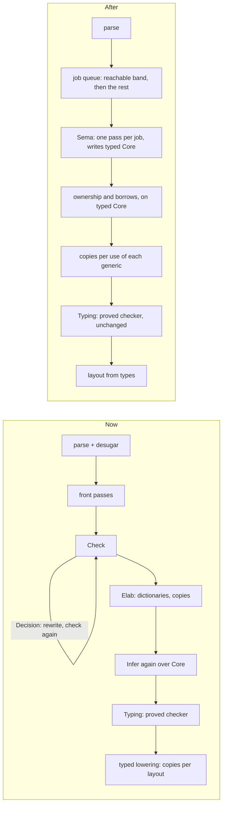

# The redesign: one checking pass, a job queue, ids for everything

This is the plan for the compiler's next shape: why, what it becomes, what
goes, and in what order it is done. `decisions.md` records each rule as it
lands; this file is the map.

## Why

The compiler part (everything but `Typing`, `Proof`, `Core`, `Bytecode` and
the runtime) is 27.6k lines of code. Zig's front end and semantic analysis
are about 81k (with comments) for a language without traits, ownership or
effects, so the size is not out of proportion to what Glorious does. Its
shape is the problem: the same work is done two or three times.

| Done more than once | Where | Lines |
|---|---|---|
| Type inference: over the source, and again over Core for the certificate | `Check`, `Infer` | 10.2k, 2.9k |
| Receivers, borrows, comparisons: decided by rewriting syntax and checking the function again (`Decision`: eta, letMut, refPats, receiver, derefField, derefReceiver, compareByRef, rest), and by front passes before checking (`receiverExpr`, `promote`, `nameBorrows`, `hoist`) | `Check`, `Elab/Specialize`, `Syntax/Resolve`, `Syntax/FlatOps` | ~1.5k |
| Generics: trait dictionaries passed as values, then copies per implementation, then copies per layout in the typed lowering; `Layout` a trait only because types reach callees as values | `Elab`, `Elab/Specialize`, `Lower` | ~1.5k |
| Identity: types compared and hashed by walking them whole; owners and traits as strings; stable names, keyed bodies and literals-by-bytes bolted on so caches survive an edit | everywhere | — |
| Keeping work between compiles: about ten caches, each keyed its own way (front passes, resolved units, checked groups, inference's instances, schemes, faces and mains, elaboration, lowering, typed lowering, parsed items, lexed texts) | `Main`, `Driver`, `Infer`, `Check/Merge` | ~1.5k |
| Checking side by side: whole checker states diffed and merged | `Check/Merge`, `Check/Program` | ~0.8k |

What other compilers do instead:

- **Zig**: one semantic pass (`Sema`, ZIR → AIR) whose output is typed;
  every coercion and address-of it decides is an instruction it emits, not a
  rewrite of the source. All types and values interned (`InternPool`), each
  an integer. Incremental compilation is dependency tracking between
  analysis units over stable ids, not per-stage caches. Generics copied per
  use in `Sema`; layouts follow from types. Analysis is lazy.
- **Jai**: declarations checked out of order by jobs that wait on what they
  name and run again when it is known; polymorphic procedures copied per
  use; one bytecode for compile-time execution and the back ends.
- **rustc** (for traits and borrowing): type checking records each
  expression's adjustments (autoref, autoderef, reborrow) in a table; the
  borrow checker runs once, on MIR, where every borrow and move is explicit.

## What it becomes

The proved checker (`Typing`) does not change. Everything certified is still
checked by it, so no part of the redesign can make a certified program
unsound: a wrong signature or hint is refused there, as now.

### 1. Ids for everything

One table interns every type, name, function, trait and implementation; each
is an integer. Equality and hashing are integer operations, and what is kept
between compiles is integers into a table that is itself kept.

- A type is a node of the table: its head and its arguments' ids. A type
  built twice is the same id. Unknowns during checking stay variables
  outside the table until they are decided.
- A function's id is stable across compiles: its path, and for one with no
  name (a closure, a block) its maker and its place among what that names,
  as `Program.sids` is now.
- Strings in control flow go: owners, trait keys, rigid type names, and the
  message parsing (`"(in function "`) become ids and structured fields.

### 2. Jobs and the queue

A job checks one thing:

- a type declaration's fields, from its own text;
- a function's signature, from its own text;
- a function's body, given the signatures of what it names;
- a trait implementation's head and conditions;
- a top-level `let` item or constant, from its value.

A job that needs what is not finished waits on it and runs again when it is
(Jai's way). Waiting cycles that are mutual recursion become one job for the
group (as groups are now); any other cycle is an error naming it.

Two bands, one queue:

1. **Reachable**: what `main` (or another root: a test, an export) reaches,
   first. Everything a reachable job depends on is itself reachable, so the
   first band never waits on the second.
2. **The rest**: every other function and item. Most of what they need is
   finished in the first band.

Everything is checked. `run`, `build` and the suite finish both bands before
anything runs. `watch` and `serve` start running the program once the first
band is done and report what the second finds when it does.

Jobs whose dependencies are finished run in parallel (Lean `Task`s). A job's
result is its own (a signature, a typed body, its errors) and goes into the
table; nothing merges checker states, so `Check/Merge` and the levels of
`Check/Program` go.

### 3. Results that do not depend on order

What a job finds depends only on its own text and the finished results of
what it names. So:

- A declaration is decided from its own text, in its own job: a `let` item's
  type from its value; a `fn` field written without effects performs none,
  as a struct's `fn` field already does; what a `fn` field captures is a type
  parameter of the declaration where it is not written. Nothing a use does
  decides a declaration. What cannot be decided so is an error that says
  what to write. (Rust is stricter: an item's type is always written,
  `const` included. Inferring a `let` item from its own value is still order
  independent, so it stays.)
- Unknowns made in one job are that job's. A job's result names only
  finished ids and its own generalized parameters, never another job's
  unknowns (what `freeze` refuses now, made impossible).
- Errors are collected from every job and reported sorted by source position.
  A job that depends on a failed one is skipped, not reported again.

### 4. Sema: one pass that writes typed Core

For each body job, one pass over the flat body (`Flat.Body`) that:

- infers types (unification, as `Check` does now), resolves traits and
  their implementations, effects, lifetimes and regions;
- writes **typed Core** as it goes: each expression's adjustments explicit
  (borrow, `&mut` borrow, dereference, reborrow, move, copy, coercion),
  each call to the chosen function, each operation and handler with its
  types. A dot call's receiver is adjusted here, by its type, as rustc's is;
- writes for each function the signature entries and hints the certificate
  needs (`Typing.SigEntry`, `Hint`), so nothing infers Core again;
- keeps for every Core node where it is in the source, for messages.

What goes: `Infer` (2.9k), `Decision` and its rewrites (`decideBody`,
`receiverBody`, `compareBody`, `refPatsBody`, `letMutRewriteF`, the eta and
rest rewrites), the front passes that borrow by syntax (`receiverExpr`,
`elementRead`, `promote`, `nameBorrows`, `hoist`), the side tables
(`argsChosen`, `dotChosen`), and checking a function again.

### 5. Ownership and borrows, once, on typed Core

The move, use-once, drop and borrow analyses (`Uses`, `Scopes`, `Borrows`:
2.9k) run once per body, on Sema's typed Core, where every borrow and move is
explicit (rustc's MIR borrow check). Their rules and messages stay; they
read explicit operations in place of reconstructing them from syntax. Where
a rule wants something written differently (`let mut x` to destroy what one
path does not use), the message says so; nothing is rewritten and checked
again.

### 6. Generics: one copy per use

After Sema, each generic function is copied once for each set of types it is
used at (monomorphized), as Zig and Jai do. The certificate already lists
every function at every signature it is used at; the program now is those
copies. Layouts follow from types.

What goes: trait dictionaries passed as values (`Elab`'s `untrait`), copies
per implementation (`Elab/Specialize`, `Elab/Lower`'s copies), `Layout` as a
trait, and the typed lowering's grouping of signatures into kinds
(`Lower/Typed` settle). A generic function no use reaches is still checked
(in its job, against its bounds) and never copied.

### 7. Keeping work between compiles: one design

Each job's result is kept, by the job's id and the ids of what it read, with
the list of what it depends on (Zig's dependency tracking). An edit queues
again the jobs whose own text changed and those that depend on a changed
result, reachable band first. A compile whose inputs all hash the same takes
the program built, as now. The ten caches and their keys go.

## What is kept

- The language, its error messages, and every program in the suite (with
  the annotations rule 3 asks for written in, each recorded in
  `decisions.md`).
- `Typing`, its proofs, `Core`, the machines, the bytecode and the VM.
- The parser and module resolution (only the desugaring that borrows by
  syntax moves into Sema).
- Flat bodies of indices (`Flat.Body`): already the right representation.

## Order of the work

Migrated in place: each step replaces a part of the compiler as it is, the old
part ripped out as the new one lands, the suite green after every step.
Building a second checker beside the first was the first plan; it is not
taken, for what reading the checker closely showed:

- A checker group's work is already a job that makes a delta of its own
  from a base state (`checkGroupKept`, `StDelta`): what is missing for the
  queue is scheduling by what each group depends on, not new jobs.
- Whether a local is a value or a cell (`let` or `let mut`) is part of the
  language: a value is moved out of, a cell is not (`replace`). Borrowing a
  `let` makes it a cell, decided before checking (`promote`); a borrow found
  only once types are known (a receiver, a comparison by reference) changes
  what the local is, which is why those are read again. Recording
  adjustments in place of reading again (rustc's way) works where nothing
  declared earlier changes; moving the rest needs locals that are places
  with moves tracked (Rust's drop flags), a change to the language's model
  that comes last, with its own design.

So, in order (hardest that does not make the same work be done twice first):

1. **The job queue.** Groups scheduled by what they depend on, reachable
   from `main` first, the rest after; each a job on a thread of its own as
   soon as what it reads is finished; results put together in a fixed order.
   Replaces the levels of `checkItems`. Every independent error collected,
   sorted by source position.
2. **One copy per use of each generic** (section 6).
3. **Adjustments in place of reading again**, where the local stays what it
   was declared (receivers by type, `derefReceiver`, `derefField`,
   comparisons of what is already borrowed).
4. **Ids** for types and names in the checker (section 1).
5. **One design for keeping work** (section 7), on the ids and the queue.
6. **`watch` and `serve` running after the reachable band.**
7. **Locals as places, and Sema writing typed Core** (sections 4 and 5):
   designed when 1–6 have landed.

Landed beside these: signatures whole, as Rust's. Each body is checked once,
from every signature, side by side, and refused where it needs more of its
callers than its signature says (`schemeWithin`): the passes that checked
bodies again from their bodies' types until they settled are gone, and with
them the state each pass carried to the next.

Merges only add. What made them change entries another state had, each
taken away, on covey/fleet: a function's type its body's (`fns`, 638: kept
its signature's, how a call is made beside it, `St.fnCalls`); declared
associated types answered by the first body (`tys`, 234: before any body);
an implementation's callables with open rows (`rows`, 39: they perform what
is written); captures made before a group, `'static`'s and declared types'
(`caps`, `capOut`, 142: each group's own, put back, `St.capUndo`; a
declared type's callable is Rust's `Box<dyn Fn()>`, or `FnOnce` where the
type is used once); bodies as written and as decided (`runFns`, 20: apart,
`St.declFns`). `StoreD.sets`, `Absorb` and `putEntry` are gone: a check
that changes what it began with has no delta, and is checked again after
the others (side by side) or not kept.

What reading the next steps closely showed (measured on covey/fleet):

- **Bodies as jobs across units** (the rest of step 1): a cold check runs
  ecs (0.93 s) and fleet (1.37 s) one after the other, every other unit
  under 25 ms; an edit takes the library units from what is kept. Doing
  their bodies side by side gains under a second, once, and nothing on an
  edit; and a unit's bodies read what its callees' bodies found (how a call
  is made, `St.fnCalls`; the bodies the count of uses follows), so they
  would wait on those. Left for after step 7, where a body's job reads
  signatures alone.
- **One copy per use** (step 2) is mostly there: `specCopy` makes a copy of
  each function for each set of implementations it is called with, so what
  `main` reaches holds no implementation as a value; the typed lowering
  lowers each function at each of its signatures and keeps one copy of each
  that lowers alike. What is left is the dictionaries' form itself
  (`untraitFn`, `implDictItem`), for what nothing reaches and for a given
  bound passed on: some hundreds of lines, not 1.2k. Read again: the form
  is the specializer's input, not a second way of running the program.
  `untraitCall` writes a call of a trait's function as a call of the
  implementation's, by name, where the checker knows it, and passes the
  implementations a generic function is given as arguments; `specCopy`
  then copies each function for the implementations it is called with,
  each `%dict k` a known implementation, so nothing `main` reaches takes
  one. Doing it in one pass (copies made from the checker's findings
  while the traits are written out) does the same work in one place;
  the lines it saves are the dictionary values' own (`implDictItem`,
  `dictExpr` where it is not known), used only by what nothing reaches,
  which is elaborated for what the elaborator alone finds. Not worth its
  risk before the checker finds those itself; left.
  Landed since: no implementation is a value when the program runs. The
  destroyers, their parts and the effects' copies of a function are copied
  for the implementations they are given as any function is; what `main`
  does not reach is elaborated only where it is given none; and so the
  values (`implDictItem`, a destroyer's value, `unrefBody`, `dictExprOf`)
  and the program made again with them where the copies would not end are
  gone, that refused as Rust refuses it. What is left of the form is the
  copier's input within one step of the lowering (`%dict k` parameters and
  arguments, erased by `specCopy` before anything else reads the function),
  as read above: the one-pass version saves those lines and no more.
- **Sema writing the certificate** (step 7): the certificate gives each
  function, closure and handler regions, loans and capabilities in Core's
  terms (`Typing.SigEntry`, `Hint`); the checker's lifetimes and captures
  are another model. Writing one from the other is the rewrite of `Infer`,
  not 1k lines beside it. What can go first is what makes a body be read
  again: the decisions, which come from locals not being places.

### Locals as places (step 7, first)

Every decision a body is read again for comes from one thing: a local is a
value or a cell (`let` or `let mut`) before it is checked, decided from its
text by the front passes (`promote`, `nameBorrows`, `borrowReceivers` with
`receiverExpr`, `elementRead`, `hoist`). Where a borrow is found only once
types are known, the local's kind changes and the body is rewritten and
checked again: a receiver taken by reference (`receiver`, 543 in the
suite), a comparison of what is not copied (`compareByRef`, 434), a field
through `Deref` (`derefField`, 333), a match of a reference against value
patterns (`refPats`, 800), a value let go on one path (`letMut`, 438, a drop
flag), a function named as a value (`eta`, 78), `..` in a tuple (`rest`,
13). fleet's `main` is checked ten times on each edit for them.

As Rust has it, a local is a place: it can be borrowed, and moved out of
where its type allows, whatever its text says; whether it is a cell in
Core is decided after it is checked, from what was found.

- **The checker.** A `let` is a place: borrowing it (`&x`, a receiver
  taken by reference, a comparison's operand) gives it a brand where it is
  first borrowed, and from then on it is used as a cell is, through loans
  that end. Each adjustment found is kept by the node it is at (a call's
  receiver borrowed or given, a field through `Deref`, a comparison by
  reference, a pattern's binding by reference, a function named as a
  value): `St.adjust`, by node. The count of uses and the borrow rules read
  the adjustment where they read the node, as they read a `&x` written.
- **Drop flags.** A value used on one path and not another, with a `drop`,
  is destroyed where it was not used: Elab gives it a flag, as Rust does,
  in place of the `letMut` decision.
- **Elab.** Makes cells of the locals the checker borrowed (Elab's own
  `promote`, from `St.adjust`), and writes each adjustment where its node is
  elaborated.
- **What goes.** `Decision` and its rewrites (`decideBody`, `receiverBody`,
  `compareBody`, `refPatsBody`, `letMutRewriteF`, the eta and rest ones),
  `checkDeciding`'s rounds, `decidedProgram`, the front passes above, the
  side tables that carry their choices (`dotRefs`, `argsChosen`,
  `dotChosen`), and checking a body again.

Slices, each landing alone with the suite green and the old path for the
rest kept until its last user goes: comparisons (operands borrowed by
type; Elab borrows them, in a cell of the value where it is a `let`); then
fields through `Deref`; then receivers; then patterns by reference; then
drop flags; then the front passes and `Decision` go.

The first slice, from the code as it is:

- A value binding has a brand already (`inferPat`'s `.val t id`, with
  `bindLoans`). `&x` of one (`inferExprRef`, refused today: the front
  passes make it a cell first) is a loan of that brand, as of a cell; the
  brand is put among `St.cells` where it is first borrowed, and each read
  of the name after is a use of it (`.var id x .move`), so `checkLoans`
  refuses one that moves it while a loan lasts; `checkEscape` where its
  block ends. Each such binding is said (`St.placed`: owner, name, site).
- Elab writes a binding `St.placed` names as it writes a `let mut`: the
  moved flag that `let mut` of a value given away already has
  (`Syntax.movedFlag`, `markMoves`) destroys it where it was not used,
  from the drop site the checker records for it as for a cell's
  (`givenSite`).
- Then the front passes stop making cells of what is borrowed
  (`promoteHeld`, `promoteRewrite`, `borrowedOnly`), a `%receiver(x)` of a
  value is `&x` or `x` as the callee takes it, decided where the call is
  checked, and `receiver`, `compareByRef` and `derefField` are found and
  written where they are met.

What the first slice showed (landed: a `let` borrowed with `&`, indexed
by a name known to hold a value, or borrowed by field, is a place; a
closure's parameter borrowed is one where the clause starts): a place's
value is destroyed where the place ends only where nothing gave it away
on any path, and the counting of uses says that of a value, not of a
place. A comparison taken by reference in place (`compareByRef` without
reading the body again) leaves its operands alive where the by-value
check counted them given away: who destroys them is the drop flag's
question. So drop flags (Elab gives each place with a `drop` a flag, set
where its value is given away, the value destroyed where the place ends
if the flag is not set; the `letMut` decision gone) come before
comparisons, receivers and fields.

How the elaborator gets what was decided, as Rust has it: the checker
keeps each node's adjustment in a table by the node's identity (Rust's
`TypeckResults`: auto-borrow, auto-deref, the method a call is of, a
pattern's binding mode), the program is never written again, and the next
stage (MIR building) reads the program and the table. A trait's default
body is checked once, generically (`Self` with the trait's bounds), so its
adjustments are the same for every implementation; copies per type come
after (monomorphization). Here the elaborator writes each decision in
again by its call's identity (`decidedProgram`), and a default is checked
once for each implementation (`Eq::!=@String`): a decision written where
it is found must be written by the elaborator alike. The first kind so
written is a dot call whose receiver is a name (`receiverHere`:
`Elab.receiverNode`, one function both use on the node alone); the others
follow the same way, and then defaults checked once.

Patterns by reference written in place (the `match`'s callable given its
`&Pattern` clauses where it is) read freed memory in covey/debugtext: the
clauses are copied into new nodes, and what the checker found of a literal
is kept by the node's place in the body (`Blocks.scalarLits`, by owner and
`ExprId`). The checker's body grows with the nodes inference makes
(`pushE`); the elaborator's does not; so a literal copied after is at
another place in each, and the elaborator wrote `1.5` as what another
literal was found to be. Rust's tables are by `HirId`, which no rewrite
moves. So the node functions here move nodes and never copy one that
holds a literal; copying clauses waits on identities for nodes that stay
(step 4, ids), and patterns by reference are decided as before.

Node identities landed (`Flat.Body.ids`, `St.scalarLits` by identity; the
clauses a decision writes from trees known in a space of the callable's
own). Patterns by reference in place tried again on them stopped before
anything ran: covey/debugtext said `element_at` unknown in the clauses
written from trees, covey/mcp_session refused a borrow the first reading
of the `match` had recorded. (The commit that landed identities says the
literals were then right; that was not seen: the program did not get to
run.) Both are what is still in the way.

Drop flags written by the elaborator where it meets a place, from the
checker's table (`Decision.letMut` read by `elabStmts` and at each clause
start, `decideBody` not writing it), tried after the certificate went:
the values were then not destroyed where one path did not give them away.
What sets and reads the flags is not the elaborator's reading of the
statement but the pass before it that writes what destroys values
(`Elab`'s block statements, `markMoves`), which finds them by `let mut`.
So the flag is the destroying pass's to write, from the table, before the
elaborator: written there, the `let mut` rewrite goes; written in the
elaborator, it is a second place that has to know.

Landed after: the elaborator elaborates the bodies the checker read
(`Blocks.bodies`, from `St.decidedFns`), with what the checker wrote where
it found it; nothing is written in again from the decisions (`decideBody`
keeps the two decided after a body is read: a variable made a place,
`letMut`, and a receiver found to be copied once the bounds were met,
`receiverCopy`), and the count of uses follows the same bodies
(`St.runFns`). `Decided` and the elaborator's copy of the decisions are
gone. The checker still rewrites a node and reads it again where a borrow
is found only once a type is known; that is what the slices below are of.

Landed after: the front end no longer makes a variable of a `let`, a
parameter or a name a pattern binds for being borrowed, indexed or
borrowed by field (`promote` keeps the names it makes up itself, those an
`is` binds for the block after it, and a `&mut [T]` written through). Each
is a place where it is first borrowed (`placeVal`), and what that asked:
- What was read of a name before it was borrowed is kept with the arms it
  was read in (`St.valReads`, `St.armPath`): a read in one clause, or one
  branch of an `if` with an `else`, is not before a borrow in another.
  A field read is a read of the field, not of the whole (`fieldRead`).
- A clause's statements leave the place they were at to the clause (what
  the compiler writes at no place in the next clause, as patterns by
  reference do, is said at the `match`, not at the last arm's statement).
- A clause's name that is a place and is only borrowed is destroyed where
  the clause ends (`placedParams`, as a `let`'s is), the names of a clause
  kept in the order the patterns bind them, so destroyed last first.

Receivers that are chains of calls (`App::new().relation(..).relation(..)`,
covey/fleet's `main`) stay decisions. Written in place, each link read
the chain below it again (1.75 s from 1.13 for fleet's check). Measured
since: the innermost link of fleet's chain is read 1458 times in one
check of `main`, the outermost twice. Speculative readings (the receiver's
type found on a copy, `dotAltFor`, and the other ways a call is tried)
read each link's receiver again and put the state back after, taking back
what was written in place, so each level reads the one below about three
times over. Keeping what was written in place across those (the body and
what was decided), and each call's type to take instead of reading it
again, left it at 1.7 s: the readings themselves are what costs. Decided
as before, the first link found ends the reading, and the group is read
again with it written; that is cheaper here. In place wants speculative
readings that keep what they find (Rust's probing is of types alone, and
commits nothing it must take back).

## Expected size

Estimates, to be replaced by measurements as each step lands.

| Step | Removed | Added |
|---|---|---|
| Sema, queue, ids | `Infer` 2.9k, decisions and front passes ~1.5k, `Merge` and levels ~0.8k, `Check` simplified | Sema's Core writing ~1k, queue ~0.4k, ids ~0.4k |
| Ownership on typed Core | ~1k of reconstruction in `Uses`/`Scopes`/`Borrows` | — |
| One copy per use | ~1.5k | ~0.3k |
| One design for keeping work | ~1.2k | ~0.4k |

Together about 7–8k fewer lines: under 20k.

## Risks

- **The size of step 1.** It replaces the heart of the compiler. Building it
  beside the old path, with the suite as the judge, keeps the old one
  working until the new one passes everything.
- **Messages.** Many rules have careful messages written against syntax;
  each keeps its text, now said at the source position Core keeps.
- **Programs the order rules refuse.** Each is edited and the rule recorded.
- **Copies per use can grow the program** where one generic function is used
  at many types; the certificate already lists each of those, so the checker
  sees no more than now.

Left of locals as places, with why:

- A name that may hold a reference, indexed (`d[1]` of a closure's `d:
  &mut Vec<Int>`), is borrowed in place as any other (done: `&mut d` of
  such a name is written `&mut *d` where the checker reads it,
  `Decision.reborrowHere`, so that a variable made of `d` is not what is
  borrowed for writing).
- The front end's own temporaries (`borrowed%N`) stay variables it makes:
  it names them in the body the checker reads, and again after.
- A value a dot call is made on, where the function of the name in scope
  takes it whole and its type's own borrows it (`v.len()` with the
  prelude's `len`), is a place too (done: `dotBorrows` for a `let`, and a
  callable's captures read those calls as borrows; the front end's
  `dotted` is gone). That needed a value a part of which is taken (`let i
  = c.items`) after a call that may not come back to be flagged as a
  whole is: the flag is set where a part with something to destroy is
  taken (`Elab.takenSite`), not where a copied one is read.

The two left of "Then", looked at and left:

- **Ids for types and names.** Done where a name was a spelling the code
  took apart: the compiler's marks of calls, of patterns and of types
  written among expressions are nodes of their own (`Syntax.Mark`,
  `Expr.mark`, `Expr.type`, `Pattern.marked`), and bounds and
  implementations keep their trait's own name (`Bound.base`,
  `ImplDecl.base`) instead of reading it back out of `Get#1<T>`. Left as
  spellings, with why: a trait at its arguments (`From<Int>`) and a
  condition (`'%condition:owner:key:type`) are names that outlive a group
  (function signatures, dictionaries in Core, what the cache keeps), and
  the type pool's numbers (`St.tyIds`) are a group's own, reset after it
  (`internTy`, already the key of the bound memos within a group). Numbers
  for them would have to be the same in every run: hashes of the
  spelling, which say less than the spelling and save nothing.
  Not fewer lines: about the same (28,286 against 28,244); fewer string
  tests (the marks' sites, about 100, and `traitBase` in the checker, 30 of 52).
- **Bodies as jobs across units.** A cold check runs ecs (0.93 s) and
  fleet (1.37 s) one after the other and every other unit under 25 ms; an
  edit takes the library from what is kept. Side by side across units
  gains under a second once, nothing on an edit.

## Step 2, as done: Core's types from Core, and the certificate gone

The certificate (`Infer`, checked by the proved `Typing.checkProgram`) is
gone, with the proofs about it (`Glorious/Proof`, `Glorious/Typing`): the
checker of the source text is what a program is held to. What the typed
lowering still needs, the type of each `let` of each function at each
signature it is used at, is found by `Glorious/Typer.lean`, which types Core
as written by unification, without regions, loans or ownership:

- each group of functions that refer to each other, in the order they
  depend on each other, at a signature of its own; each use takes a copy,
  with what the group left undecided that the copy can still decide
  (`Asks`, kept only where it mentions the signature, `liveAsks`);
- then, from `main`, each function at each signature a use gives it, its
  body gone through again at those types, which decides its locals' and
  the closures' it makes (`instAt`).

The types (`Lower.Types`: `Ty` without regions, `FnSig`, `Hint.ty`,
`Hint.handler`) are what `Lower.Typed` reads. Where they are not found the
program runs unlowered.

Tried first and dropped: reading the checker's type of each expression
(`St.nodeTys`, by node identity) into the elaborator's lets. The elaborator
works on bodies the front passes and the checker's decisions rewrote, so
node identities do not line up with the checker's, and a wrong type found
that way is one the lowering lays out wrongly, without saying so.

With the certificate the search for borrows that can be scopes of their own
went (`certifyWith`, places, the `certify` command): every borrow is the
reference it borrows (`lends` is `0`), which changes nothing a program does.

## Step 5, as done: one record of each stage's results

What a compile of a program takes from the last one and makes for the next is
one record (`Driver.Memos`): each stage's results by a key that stays the same
for as long as what the result is made from does (texts and modules' items by
their text, groups of the program's text by place and text, units by what
resolution reads, front-end results and checker groups by their inputs'
hashes, functions as lowered and elaborated by name with the key of what they
were made from). `compileSource` takes it whole (`memos`) and gives it back
(`Compiled.made`); the nine separate parameters and fields, and their
separate ways of being kept (`saveKept`, `keptIn`, `saveShards`,
`loadShards`, the checks of what changed, the rule for the unit of `main`),
are gone. On disk each stage is kept one way (`Main.saveStage`,
`loadStage`): eight files, each result in the one its key falls to, a file
written again only where a result made falls to it that is not the one kept;
the checker's groups keep those of earlier versions of the program too, for
an edit taken back. Measured on a copy of covey/fleet: 7.9 s cold, 2.0 s
after adding a function (check 1.0 s).

What is kept for any program (the prelude parsed, the prelude and library as
checked, the library's units) is in the library's directory, as before.

Left of section 7: a job's result is kept by the hash of what it read, not
by ids with a list of what it depends on; an edit finds the jobs to do again
by their keys changing, which comes to the same where the keys hash all a
job reads.

## Step 7, the front passes: what is left decides nothing

The front end decides no borrow. What `receiverExpr`, `elementRead`,
`promote` and `nameBorrows` decided from the text (which names are values,
variables or references; what a dot call's receiver is borrowed as, by the
function's declared first parameter, `takesReference`, or its result,
`givesReference`; a `&mut [T]` written through; a name an `is` binds only
borrowed) is the checker's, by types: `elementBase`, `receiverByName`,
`writeFieldReceiver`, `writeElementReceiver`, `elementPlaceFor`,
`variableReceivers`, `placeVal` with `heldFirst` in the elaborator.
`promote` is gone, and so is every separate front pass after the parser:
what is left of the others is desugaring done where name resolution writes
a function's body (`Modules.resolveFnF`, `Flat.desugarClause`), each body
from itself alone: a dot call's receiver marked for the checker
(`%receiver`), a value made where it is called on named for the statement
(`Mark.held`), `a[i]` read where it is (`*element_at(&a, i)`), and what is
borrowed named first (`nameBorrows`, and the parser's `hoist` of a field
borrowed through what an expression points to, which says where that is
computed out of turn).

## Step 7, ownership: what the analyses read

The count of uses, the scopes and the borrows (`Uses`, `Scopes`, `Borrows`)
read the checker's body as it is once a binding's statements are read: every
borrow a node of its own (`&x`, `&x.f`, `&mut ..`, the element's place), a
dot call's receiver as the call takes it (no `%receiver` mark is left in a
body once read: none the body reaches, in the suite or covey/fleet), a comparison of what is not copied
written by reference, the borrows the type's own functions make written
where they are (`writeDotBorrows`; the copies of the body patched with them
for each analysis, `St.dotRefs`, are gone). What each still works out
itself, with why:

- A field of a copied type read of a name, `x.f`, is no use of `x`: where
  every part of the name read is of a copied type, each read is written
  `%copied(x.f)` in the body (`Flat.copiedReads`, `Mark.copied`), which the
  count reads as taking nothing and the elaborator as the read.
- Which of several callables runs is followed through the bodies of the
  functions that take them (`pathUses`), as conditionals are functions
  here (`if`, `else`, `match` arms are callables given to them): Rust's MIR
  has the branches as its own control flow.
- Whether a binding is given away or only borrowed is read off its
  statements once they are read (`givenAway` of the body as read,
  `closeCell`); nothing is read off statements ahead of reading them.

They run on the checker's flat bodies, as each binding's statements are
read, not on Core after the elaborator: their messages are of the text,
and Core has no places of the text's names. What makes a body be read
again in parts is four adjustments found once a type is (`compareHere`,
1012 in the suite; `refPatsHere`, 800; `receiverHere`, 500; `etaHere`,
66): each written where it is and the expression read on, what the first
reading recorded taken back (`Marks`), never the function again.

## Step 7, as done: nothing read again

What made a body be read again is gone (redesign step 7's slices):

- Comparisons are decided by what they compare before they are read
  (`compareByType`; the front end names an operand that is no name or
  literal first).
- Receivers: the type's own function and how it takes the receiver are
  decided before the call is read (`inferDotAltCall`, `ownCall`,
  `chosenCall`, a first argument borrowed in `checkArgs`); what was chosen
  is written into the call where it is (`writeCall`), not carried in side
  tables (`dotChosen`, `argsChosen` gone).
- A function named as a value is made a block that calls it before the
  name is read (`etaArity`); patterns by reference are written before the
  clauses are read (`checkArgsIn`); `..`, `Deref` fields and reborrows were
  so already.
- A call's arguments and a callable's clauses are read once: a coercion
  applies where the expected type is known as the value is read
  (decisions.md).
- `Decision` is the table of adjustments by node, `St.adjust`
  (`Elab.Adjust`: `..` and the places, which the elaborator makes cells,
  `Elab.promote`); `receiverRetry`, `Marks`, `decideBody`,
  `Said.decision` are gone. Values used on one path and not another get a
  drop flag from the destroying pass (`Elab.flagged`), not a `let mut`.
- A trait's default body is checked once, as a function of its own generic
  in `Self` with the trait's bound and what its signature asks of types
  made of `Self` (`%default:Trait::f`, a bound said of a type,
  `Syntax.Bound.subjectTy`); an implementation that does not write the
  function calls it at its type, and copies are made per type as for any
  generic function.

What the checker still tries and lets go (a receiver's type, a field's,
`dotAltReading`) is put back as it was: a probe, as rustc's method probe is
of types.

## Step 4, as done: what the checker gives the elaborator

The elaborator elaborates the checker's bodies (`Blocks.bodies`), with
every adjustment the checker found written where it is: borrows and
`&mut` borrows of receivers and operands (`receiverByName`,
`writeFieldReceiver`, `writeElementReceiver`, `writeDotBorrows`,
`compareNode`), dereferences through `Deref` (`derefNode`), reborrows
(`reborrowNode`), patterns by reference (`refPatsNode`), functions named as
values made blocks (`etaNode`), the function a dot call is of and the
arguments it is given (`writeCall`), coercions as calls of them
(`coerceFn`), literals of a scalar type and texts where `&str` is wanted
(`scalarBody`), borrows of fields and fields read by name written out
(`unfieldBody`), blocks that take an argument they do not name
(`givenBody`). What it keeps by node beside the bodies, as rustc's
`TypeckResults` beside HIR: which implementation each call of a trait's
function is and what each function is given (`TraitInfo`, read by the
copier, `Elab.Lower`), which instance of an effect each operation and
handler is (`sites`), the places (`places`) and what destroys what
(`drops`, `destroys`). A position is kept per statement (`located`), which
is where every message is said.

## Step 5, as done: ownership once per function

Each count of uses (`checkUses`) and each search for what outlives a scope
(`checkEscape`'s, `escapeSearch`) is recorded where its binding or scope
is read and made once the function is read (`countUsesNow`), of the body
as read with every adjustment in it; loans are checked once per group
(`checkLoans`). Nothing is rewritten and read again: a callable argument is
read once at the parameter types wanted, a dot call of a type's own
function is decided before it is read, and the refusal kept from a first
reading (`firstSaid`) is gone. What is looked at before reading is looked
at on a copy of what is known and let go, as rustc's method probing is
made in `InferCtxt::probe`: a dot call's receiver's type (`dotAltReading`,
the field callee's, a receiver that is a reference already), a coercion's
fit, a lifetime's fit.

## Step 4, Core's types: what writing them from the checker needs

Measured (checker's type of each expression kept by node, `St.nodeTys`;
the elaborator's local made for each expression noted; `Typer` comparing
the two where the checker's type is whole): of covey/fleet's Core, 867
locals were found an expression's type, 146 agreeing with `Typer`'s and 137
not; of `b.glorious`, 9 and 9. They do not line up because writing out a
function for its implementations (`Elab.untraitFn`) makes every node anew
and numbers them again (`Flat.Body.compact`): a node's place in the body
is not its identity past the checker. Only calls, closures and fields
carry an identity of their own (`.call id ..`).

So Core's types from the checker need, in order:

1. every expression an identity that the elaborator's passes keep (writing
   out implementations, effects' copies, destroyers, `compact`), as calls'
   are: section 1's ids, of expressions;
2. the elaborator typing what it writes itself as it writes it (cells,
   labels, closures and what they capture, handlers and the operations
   they serve, destroyers, drop flags, places): each local's type from its
   parts', no unification;
3. each function at each signature from the instantiation the checker
   found at each call (the callee's type there), by substitution from
   `main`, in place of `Typer.instAt`.

Then `Typer` goes.

1, done: every node has an identity (`Flat.Body.ids`, `idOf`, as rustc's
`HirId`) that writing a body out again keeps: `compact` and the writing
out of implementations (`untraitExpr`, `untraitCall`) now keep it, as
`FRewrite` did (`Flat.pushExprAs`). The checker keeps the type of each
expression whose type it knows whole by that identity (`St.nodeTys`,
`bodyTys`, `Blocks.nodeTys`), and the elaborator notes, for each local, the
identity of the expression it is made for (`Builder.nodes`,
`Output.fnNodes`). `Typer` compares them (`GLORIOUS_TRACE`): of
covey/fleet's Core, 27,148 locals have the checker's type, 6,662 of the
`let`s it compares agreeing, 8 not, 146 not decided by it.

## Section 3, as done: results that do not depend on order

- A declaration is decided from its own text: a `let` item's type is its
  value's, generic where the value is (`let XS = [];` used as `[Int; 0]`
  and `[Bool; 0]` both); a `fn` field performs what it says, nothing where
  it says nothing; a callable stored in a declaration's `fn` field holds
  nothing borrowed unless the declaration has a type parameter for it (the
  refusal says to give it one).
- Each body is checked once from the signatures, side by side with the
  others (`schemeWithin`): what one body leaves undecided no other reads.
- Every refusal is said, sorted by where it is: bodies' (a group that calls
  a refused one not read), and declarations' and implementations' (what
  names one refused not read), `St.declFailed`, `sortedErrors`.

2, as it stands (`Glorious/Hints.lean`, beside `Typer`, `GLORIOUS_TRACE=hints`):
each clause of each function at each signature `Typer` found is gone
through once, forward, on its own types: a local's type from its parts',
the checker's type of the expression it is made for, a function's type
parameters learned from what it is given and gives (`matchTy`), and a
closure the checker said nothing of typed where it is first used as a
callable (`useOf`, `fnRet`). Its hints line up with `Typer`'s in every
clause of covey/fleet; what they are compared on is the types without what
callables perform and were made with (`shape`). Left before `Typer` can
go: the hints not found yet (about 2,300 callables, 170 declared types, 60
others, 290 handlers: effects with arguments), what callables perform
(the checker's rows, as operations), each function at each signature from
`main` (step 3), and the declared types and operations those use
(`Typer.declsFor`, kept).

2 and 3, as they stand: `Hints.typesOf` (on asking, `GLORIOUS_TYPES=hints`)
gives Core's types as `Typer.typesOf` does, each function at each
signature found from `main` (closures as they are made, handlers'
functions, destroyers). With it the suite types 1,368 programs of the
1,464 `Typer` types, and every hint it finds of covey/fleet agrees with
`Typer`'s. What is left is one thing: a type parameter of a function that
nothing it is given or gives shows (`World::query<Q>`, an implementation's
`Q` of `Fetch for (Q, ..)` in its copy for a type), which `Typer` finds by
unification over the body and the checker knows only where the function
is called: the checker is to keep, at each call, what each type parameter
of the callee is (in the caller's), so that from `main` each function's
parameters are known. Then `Typer` goes.

Found on the way: a program the lowering does not take runs on the
unlowered machine, and some give other output there
(`GLORIOUS_UNLOWERED=1`: `o == Some(p.name.clone())` of texts is false);
the suite does not see it, as every program it has is lowered.

As it stands after the call-site instantiations, the copies' identities
and operations' results: `GLORIOUS_TYPES=hints` types 1,403 programs of
the suite's 1,464 (1,386 lowered); of the 1,959 cases run both ways, one
gives other output (`each_mut` over two `Store` handlers: a text read back
empty). What `Typer` has that the forward types do not: what each callable
was made with (`env`) where the callable reaches a place by a declared
type (a field, a parameter written `fn(..)`), and what each signature
performs (`eff`, `Typer`'s one row for the code around), both found by
unifying how a callable flows. Until those are written by the checker
(each callable's captures and row at each place it flows to), `Typer`
stays the default.

2 and 3, done: `Typer` is gone. Core's types are found forward from the
checker's (`Hints.typesOf`), from `main`. What the checker keeps for it,
besides each expression's type by its node and each callee's type
parameters at each call: what runs a handled computation performs (what is
handled and what the code around may); a callable whose row it leaves open
written so (`%open`, performing what the code around does, one row); for
each implementation it fits to a bound, what its type parameters are there
(`St.dictTypes`, by dictionary object; none where one object or number is
found at others), so that a copy of an implementation's function is typed
at them (`Elab.Lowered.implTypes`); and each type a body reads from what a
trait leaves to the implementation of one of its bounds, by which bound
and at what it is asked (`St.projAt`, `%proj:j:Name`), which the
elaborator works out for each copy from the implementations it is given
(`Elab.assocAt`, `Lowered.projTypes`, through their conditions'). A node
the elaborator makes is known apart from the checker's (`Flat.elabIdBase`;
one in a space of its own raises nothing, `Body.add`). `Hints` takes what
it used of `Typer`: the declarations (`Decls`, `declsOf`) and the declared
types and operations the types use (`declsFor`, now without unification).

## Section 6, layouts, as done

Layouts follow from types (F1): `writeLayouts` and its `layoutOf`/`reprOf`
are gone, with the `Layout` and `Repr` traits and every implementation
written out for them; `size_of`, `align_of`, `repr_store` and `repr_load`
are the prelude's functions over the lowering's layout (`size_of_at`,
`ptr_ref_at`, `read_out`, `overwrite`). What made it possible: a function's
signature carries the type arguments its values do not show
(`FnSig.targs`, `Hint.inst`), found from each call's instantiation
(`Hints.W.useAt`, `Env.phantoms`), so that `size_of<u8>` and
`size_of<Shape>` are copies of their own; and the typed lowering makes a
copy of each signature (`targetsOf`), the grouping of signatures into kinds
(`settle`) gone. `NilRepresented`, a bound a program asks, is still written
out for each type that is nothing (`writeNils`).

