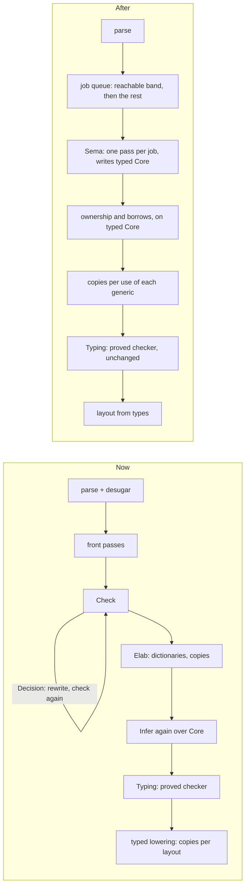

# The redesign: one checking pass, a job queue, ids for everything

This is the plan for the compiler's next shape: why, what it becomes, what
goes, and in what order it is done. `decisions.md` records each rule as it
lands; this file is the map.

## Why

The compiler part (everything but `Typing`, `Proof`, `Core`, `Bytecode` and
the runtime) is 27.6k lines of code. Zig's front end and semantic analysis
are about 81k (with comments) for a language without traits, ownership or
effects, so the size is not out of proportion to what Glorious does. Its
shape is the problem: the same work is done two or three times.

| Done more than once | Where | Lines |
|---|---|---|
| Type inference: over the source, and again over Core for the certificate | `Check`, `Infer` | 10.2k, 2.9k |
| Receivers, borrows, comparisons: decided by rewriting syntax and checking the function again (`Decision`: eta, letMut, refPats, receiver, derefField, derefReceiver, compareByRef, rest), and by front passes before checking (`receiverExpr`, `promote`, `nameBorrows`, `hoist`) | `Check`, `Elab/Specialize`, `Syntax/Resolve`, `Syntax/FlatOps` | ~1.5k |
| Generics: trait dictionaries passed as values, then copies per implementation, then copies per layout in the typed lowering; `Layout` a trait only because types reach callees as values | `Elab`, `Elab/Specialize`, `Lower` | ~1.5k |
| Identity: types compared and hashed by walking them whole; owners and traits as strings; stable names, keyed bodies and literals-by-bytes bolted on so caches survive an edit | everywhere | — |
| Keeping work between compiles: about ten caches, each keyed its own way (front passes, resolved units, checked groups, inference's instances, schemes, faces and mains, elaboration, lowering, typed lowering, parsed items, lexed texts) | `Main`, `Driver`, `Infer`, `Check/Merge` | ~1.5k |
| Checking side by side: whole checker states diffed and merged | `Check/Merge`, `Check/Program` | ~0.8k |

What other compilers do instead:

- **Zig**: one semantic pass (`Sema`, ZIR → AIR) whose output is typed;
  every coercion and address-of it decides is an instruction it emits, not a
  rewrite of the source. All types and values interned (`InternPool`), each
  an integer. Incremental compilation is dependency tracking between
  analysis units over stable ids, not per-stage caches. Generics copied per
  use in `Sema`; layouts follow from types. Analysis is lazy.
- **Jai**: declarations checked out of order by jobs that wait on what they
  name and run again when it is known; polymorphic procedures copied per
  use; one bytecode for compile-time execution and the back ends.
- **rustc** (for traits and borrowing): type checking records each
  expression's adjustments (autoref, autoderef, reborrow) in a table; the
  borrow checker runs once, on MIR, where every borrow and move is explicit.

## What it becomes

The proved checker (`Typing`) does not change. Everything certified is still
checked by it, so no part of the redesign can make a certified program
unsound: a wrong signature or hint is refused there, as now.

### 1. Ids for everything

One table interns every type, name, function, trait and implementation; each
is an integer. Equality and hashing are integer operations, and what is kept
between compiles is integers into a table that is itself kept.

- A type is a node of the table: its head and its arguments' ids. A type
  built twice is the same id. Unknowns during checking stay variables
  outside the table until they are decided.
- A function's id is stable across compiles: its path, and for one with no
  name (a closure, a block) its maker and its place among what that names,
  as `Program.sids` is now.
- Strings in control flow go: owners, trait keys, rigid type names, and the
  message parsing (`"(in function "`) become ids and structured fields.

### 2. Jobs and the queue

A job checks one thing:

- a type declaration's fields, from its own text;
- a function's signature, from its own text;
- a function's body, given the signatures of what it names;
- a trait implementation's head and conditions;
- a top-level `let` item or constant, from its value.

A job that needs what is not finished waits on it and runs again when it is
(Jai's way). Waiting cycles that are mutual recursion become one job for the
group (as groups are now); any other cycle is an error naming it.

Two bands, one queue:

1. **Reachable**: what `main` (or another root: a test, an export) reaches,
   first. Everything a reachable job depends on is itself reachable, so the
   first band never waits on the second.
2. **The rest**: every other function and item. Most of what they need is
   finished in the first band.

Everything is checked. `run`, `build` and the suite finish both bands before
anything runs. `watch` and `serve` start running the program once the first
band is done and report what the second finds when it does.

Jobs whose dependencies are finished run in parallel (Lean `Task`s). A job's
result is its own (a signature, a typed body, its errors) and goes into the
table; nothing merges checker states, so `Check/Merge` and the levels of
`Check/Program` go.

### 3. Results that do not depend on order

What a job finds depends only on its own text and the finished results of
what it names. So:

- A declaration is decided from its own text, in its own job: a `let` item's
  type from its value; a `fn` field written without effects performs none,
  as a struct's `fn` field already does; what a `fn` field captures is a type
  parameter of the declaration where it is not written. Nothing a use does
  decides a declaration. What cannot be decided so is an error that says
  what to write. (Rust is stricter: an item's type is always written,
  `const` included. Inferring a `let` item from its own value is still order
  independent, so it stays.)
- Unknowns made in one job are that job's. A job's result names only
  finished ids and its own generalized parameters, never another job's
  unknowns (what `freeze` refuses now, made impossible).
- Errors are collected from every job and reported sorted by source position.
  A job that depends on a failed one is skipped, not reported again.

### 4. Sema: one pass that writes typed Core

For each body job, one pass over the flat body (`Flat.Body`) that:

- infers types (unification, as `Check` does now), resolves traits and
  their implementations, effects, lifetimes and regions;
- writes **typed Core** as it goes: each expression's adjustments explicit
  (borrow, `&mut` borrow, dereference, reborrow, move, copy, coercion),
  each call to the chosen function, each operation and handler with its
  types. A dot call's receiver is adjusted here, by its type, as rustc's is;
- writes for each function the signature entries and hints the certificate
  needs (`Typing.SigEntry`, `Hint`), so nothing infers Core again;
- keeps for every Core node where it is in the source, for messages.

What goes: `Infer` (2.9k), `Decision` and its rewrites (`decideBody`,
`receiverBody`, `compareBody`, `refPatsBody`, `letMutRewriteF`, the eta and
rest rewrites), the front passes that borrow by syntax (`receiverExpr`,
`elementRead`, `promote`, `nameBorrows`, `hoist`), the side tables
(`argsChosen`, `dotChosen`), and checking a function again.

### 5. Ownership and borrows, once, on typed Core

The move, use-once, drop and borrow analyses (`Uses`, `Scopes`, `Borrows`:
2.9k) run once per body, on Sema's typed Core, where every borrow and move is
explicit (rustc's MIR borrow check). Their rules and messages stay; they
read explicit operations in place of reconstructing them from syntax. Where
a rule wants something written differently (`let mut x` to destroy what one
path does not use), the message says so; nothing is rewritten and checked
again.

### 6. Generics: one copy per use

After Sema, each generic function is copied once for each set of types it is
used at (monomorphized), as Zig and Jai do. The certificate already lists
every function at every signature it is used at; the program now is those
copies. Layouts follow from types.

What goes: trait dictionaries passed as values (`Elab`'s `untrait`), copies
per implementation (`Elab/Specialize`, `Elab/Lower`'s copies), `Layout` as a
trait, and the typed lowering's grouping of signatures into kinds
(`Lower/Typed` settle). A generic function no use reaches is still checked
(in its job, against its bounds) and never copied.

### 7. Keeping work between compiles: one design

Each job's result is kept, by the job's id and the ids of what it read, with
the list of what it depends on (Zig's dependency tracking). An edit queues
again the jobs whose own text changed and those that depend on a changed
result, reachable band first. A compile whose inputs all hash the same takes
the program built, as now. The ten caches and their keys go.

## What is kept

- The language, its error messages, and every program in the suite (with
  the annotations rule 3 asks for written in, each recorded in
  `decisions.md`).
- `Typing`, its proofs, `Core`, the machines, the bytecode and the VM.
- The parser and module resolution (only the desugaring that borrows by
  syntax moves into Sema).
- Flat bodies of indices (`Flat.Body`): already the right representation.

## Order of the work

Migrated in place: each step replaces a part of the compiler as it is, the old
part ripped out as the new one lands, the suite green after every step.
Building a second checker beside the first was the first plan; it is not
taken, for what reading the checker closely showed:

- A checker group's work is already a job that makes a delta of its own
  from a base state (`checkGroupKept`, `StDelta`): what is missing for the
  queue is scheduling by what each group depends on, not new jobs.
- Whether a local is a value or a cell (`let` or `let mut`) is part of the
  language: a value is moved out of, a cell is not (`replace`). Borrowing a
  `let` makes it a cell, decided before checking (`promote`); a borrow found
  only once types are known (a receiver, a comparison by reference) changes
  what the local is, which is why those are read again. Recording
  adjustments in place of reading again (rustc's way) works where nothing
  declared earlier changes; moving the rest needs locals that are places
  with moves tracked (Rust's drop flags), a change to the language's model
  that comes last, with its own design.

So, in order (hardest that does not make the same work be done twice first):

1. **The job queue.** Groups scheduled by what they depend on, reachable
   from `main` first, the rest after; each a job on a thread of its own as
   soon as what it reads is finished; results put together in a fixed order.
   Replaces the levels of `checkItems`. Every independent error collected,
   sorted by source position.
2. **One copy per use of each generic** (section 6).
3. **Adjustments in place of reading again**, where the local stays what it
   was declared (receivers by type, `derefReceiver`, `derefField`,
   comparisons of what is already borrowed).
4. **Ids** for types and names in the checker (section 1).
5. **One design for keeping work** (section 7), on the ids and the queue.
6. **`watch` and `serve` running after the reachable band.**
7. **Locals as places, and Sema writing typed Core** (sections 4 and 5):
   designed when 1–6 have landed.

Landed beside these: signatures whole, as Rust's. Each body is checked once,
from every signature, side by side, and refused where it needs more of its
callers than its signature says (`schemeWithin`): the passes that checked
bodies again from their bodies' types until they settled are gone, and with
them the state each pass carried to the next.

Merges only add. What made them change entries another state had, each
taken away, on covey/fleet: a function's type its body's (`fns`, 638: kept
its signature's, how a call is made beside it, `St.fnCalls`); declared
associated types answered by the first body (`tys`, 234: before any body);
an implementation's callables with open rows (`rows`, 39: they perform what
is written); captures made before a group, `'static`'s and declared types'
(`caps`, `capOut`, 142: each group's own, put back, `St.capUndo`; a
declared type's callable is Rust's `Box<dyn Fn()>`, or `FnOnce` where the
type is used once); bodies as written and as decided (`runFns`, 20: apart,
`St.declFns`). `StoreD.sets`, `Absorb` and `putEntry` are gone: a check
that changes what it began with has no delta, and is checked again after
the others (side by side) or not kept.

What reading the next steps closely showed (measured on covey/fleet):

- **Bodies as jobs across units** (the rest of step 1): a cold check runs
  ecs (0.93 s) and fleet (1.37 s) one after the other, every other unit
  under 25 ms; an edit takes the library units from what is kept. Doing
  their bodies side by side gains under a second, once, and nothing on an
  edit; and a unit's bodies read what its callees' bodies found (how a call
  is made, `St.fnCalls`; the bodies the count of uses follows), so they
  would wait on those. Left for after step 7, where a body's job reads
  signatures alone.
- **One copy per use** (step 2) is mostly there: `specCopy` makes a copy of
  each function for each set of implementations it is called with, so what
  `main` reaches holds no implementation as a value; the typed lowering
  lowers each function at each of its signatures and keeps one copy of each
  that lowers alike. What is left is the dictionaries' form itself
  (`untraitFn`, `implDictItem`), for what nothing reaches and for a given
  bound passed on: some hundreds of lines, not 1.2k.
- **Sema writing the certificate** (step 7): the certificate gives each
  function, closure and handler regions, loans and capabilities in Core's
  terms (`Typing.SigEntry`, `Hint`); the checker's lifetimes and captures
  are another model. Writing one from the other is the rewrite of `Infer`,
  not 1k lines beside it. What can go first is what makes a body be read
  again: the decisions, which come from locals not being places.

### Locals as places (step 7, first)

Every decision a body is read again for comes from one thing: a local is a
value or a cell (`let` or `let mut`) before it is checked, decided from its
text by the front passes (`promote`, `nameBorrows`, `borrowReceivers` with
`receiverExpr`, `elementRead`, `hoist`). Where a borrow is found only once
types are known, the local's kind changes and the body is rewritten and
checked again: a receiver taken by reference (`receiver`, 543 in the
suite), a comparison of what is not copied (`compareByRef`, 434), a field
through `Deref` (`derefField`, 333), a match of a reference against value
patterns (`refPats`, 800), a value let go on one path (`letMut`, 438, a drop
flag), a function named as a value (`eta`, 78), `..` in a tuple (`rest`,
13). fleet's `main` is checked ten times on each edit for them.

As Rust has it, a local is a place: it can be borrowed, and moved out of
where its type allows, whatever its text says; whether it is a cell in
Core is decided after it is checked, from what was found.

- **The checker.** A `let` is a place: borrowing it (`&x`, a receiver
  taken by reference, a comparison's operand) gives it a brand where it is
  first borrowed, and from then on it is used as a cell is, through loans
  that end. Each adjustment found is kept by the node it is at (a call's
  receiver borrowed or given, a field through `Deref`, a comparison by
  reference, a pattern's binding by reference, a function named as a
  value): `St.adjust`, by node. The count of uses and the borrow rules read
  the adjustment where they read the node, as they read a `&x` written.
- **Drop flags.** A value used on one path and not another, with a `drop`,
  is destroyed where it was not used: Elab gives it a flag, as Rust does,
  in place of the `letMut` decision.
- **Elab.** Makes cells of the locals the checker borrowed (Elab's own
  `promote`, from `St.adjust`), and writes each adjustment where its node is
  elaborated.
- **What goes.** `Decision` and its rewrites (`decideBody`, `receiverBody`,
  `compareBody`, `refPatsBody`, `letMutRewriteF`, the eta and rest ones),
  `checkDeciding`'s rounds, `decidedProgram`, the front passes above, the
  side tables that carry their choices (`dotRefs`, `argsChosen`,
  `dotChosen`), and checking a body again.

Slices, each landing alone with the suite green and the old path for the
rest kept until its last user goes: comparisons (operands borrowed by
type; Elab borrows them, in a cell of the value where it is a `let`); then
fields through `Deref`; then receivers; then patterns by reference; then
drop flags; then the front passes and `Decision` go.

## Expected size

Estimates, to be replaced by measurements as each step lands.

| Step | Removed | Added |
|---|---|---|
| Sema, queue, ids | `Infer` 2.9k, decisions and front passes ~1.5k, `Merge` and levels ~0.8k, `Check` simplified | Sema's Core writing ~1k, queue ~0.4k, ids ~0.4k |
| Ownership on typed Core | ~1k of reconstruction in `Uses`/`Scopes`/`Borrows` | — |
| One copy per use | ~1.5k | ~0.3k |
| One design for keeping work | ~1.2k | ~0.4k |

Together about 7–8k fewer lines: under 20k.

## Risks

- **The size of step 1.** It replaces the heart of the compiler. Building it
  beside the old path, with the suite as the judge, keeps the old one
  working until the new one passes everything.
- **Messages.** Many rules have careful messages written against syntax;
  each keeps its text, now said at the source position Core keeps.
- **Programs the order rules refuse.** Each is edited and the rule recorded.
- **Copies per use can grow the program** where one generic function is used
  at many types; the certificate already lists each of those, so the checker
  sees no more than now.
